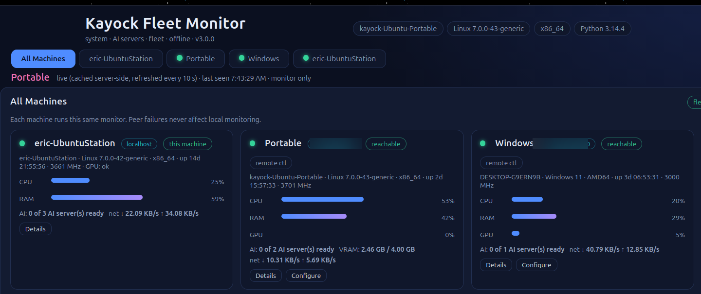
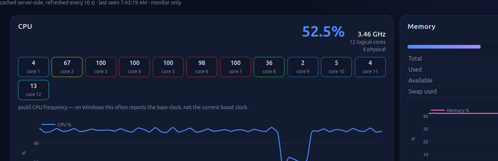
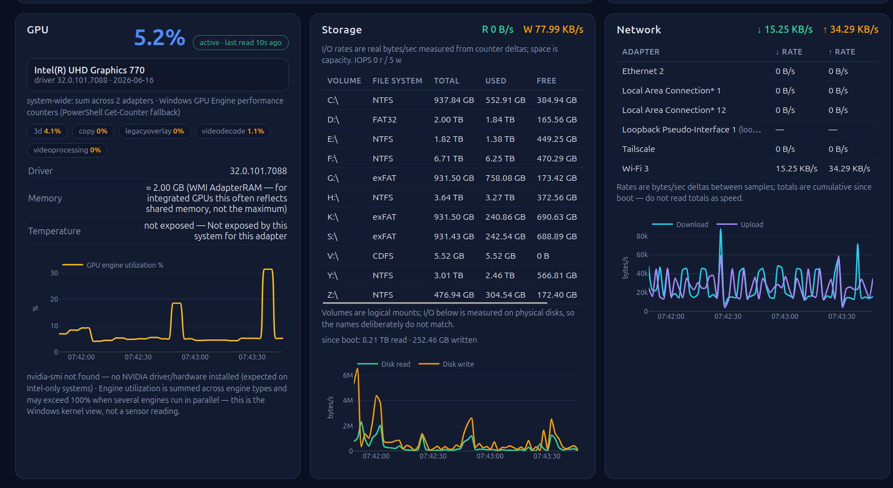
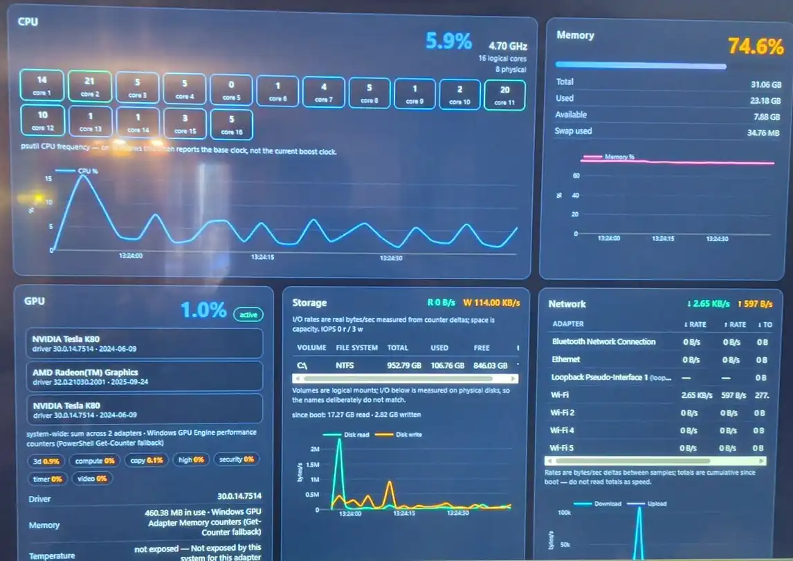

# Kayock Fleet Monitor

A cross-platform (Windows 11 + Ubuntu Linux) browser dashboard for **system
health, AI model servers and three-machine fleet monitoring**. Each machine
runs the same Python application and shares one frontend; the fleet works
from any machine and keeps working locally when the others are offline.

## Live dashboard preview



The real-world dashboard has been recorded running across **Windows Dell, Ubuntu Portable, and Ubuntu Station**. The walkthrough shows live CPU, memory, GPU, storage and network telemetry, switching between a per-machine view and **All Machines**, LAN peer discovery, and the fleet-wide AI model server inventory. See the [full screenshot gallery](#screenshots) for readable captures of each view.

---

No AI model, no external AI service, no cloud connection: the JavaScript
chart library (Plotly) and the stylesheet are bundled locally, so the
dashboard runs fully offline after setup.

---

## Supported platforms (reference deployment)

| Machine | OS | GPU | Role |
| --- | --- | --- | --- |
| **Windows Dell** | Windows 11 | Intel UHD 770 | Local AI inference (llama-server etc.), full dashboard |
| **Ubuntu Station** | Ubuntu Linux | Intel HD Graphics 630 | Own monitor, opens the full fleet dashboard |
| **Ubuntu Portable** | Ubuntu Linux | NVIDIA Quadro P2000 (4 GB) | Own monitor, opens the full fleet dashboard |

Hardware is detected at runtime (CPU, cores, clocks, RAM, disks, NICs, GPU,
running AI servers). Nothing beyond the table above is assumed.

## Installation

### Windows Dell
1. Extract the folder anywhere (e.g. `C:\Tools\KayockFleetMonitor`).
2. Double-click **`setup_windows.bat`** (one-time; creates `.venv`, installs
   Flask + psutil).
3. Double-click **`start_monitor.bat`** → dashboard opens at
   `http://127.0.0.1:5000`.
4. Optional — expose it to the LAN so the Ubuntu machines can monitor it:
   set `"host": "0.0.0.0"` in `monitor_config.json`, or start with
   `--host 0.0.0.0`. Allow inbound TCP to the chosen monitor port **from your trusted LAN** in Windows Firewall; LAN listening alone does not bypass a firewall. Keep this dashboard off the public internet.

### Ubuntu Station / Ubuntu Portable
1. Extract the folder (e.g. `~/KayockFleetMonitor`).
2. `./setup_linux.sh` (one-time; needs `python3` and `python3-venv`).
3. `./start_linux.sh` → dashboard opens at `http://127.0.0.1:5000`.
4. LAN access: `./start_linux.sh --host 0.0.0.0` (and set a friendly tab
   name: `./start_linux.sh --host 0.0.0.0 --name "Ubuntu Station"`).
5. Optional GPU tools (the dashboard shows honest `unavailable` states
   without them — never invented numbers):
   - Portable (NVIDIA): `sudo apt install nvidia-utils-550` (provides
     `nvidia-smi`) — reports utilization, VRAM used/total, temperature,
     power draw/limit; per-process VRAM of AI servers via compute-apps.
   - Station (Intel): `sudo apt install intel-gpu-tools pciutils` —
     `intel_gpu_top` adds GPU utilization when perf permissions allow;
     i915 sysfs frequency is read without any extra tools. Per-card VRAM is
     not exposed by i915 for integrated GPUs (shared memory) and is shown
     as unavailable.

### Connecting the fleet

The monitor's **web port** must be reachable via TCP from other computers. UDP discovery (port 51015) can succeed even if Windows Firewall blocks TCP; a discovered machine is not necessarily reachable. A server may choose a different free port if 5000 is occupied. Use the port actually announced by its monitor, not the AI inference server's port.

For Windows on a trusted home LAN, an administrator may create a local-subnet-only inbound rule for the actual monitor port (example for port 5000):

```powershell
New-NetFirewallRule -DisplayName "Kayock Fleet Monitor LAN" -Direction Inbound -Protocol TCP -LocalPort 5000 -Action Allow -Profile Any -RemoteAddress LocalSubnet
```

This does **not** change the Windows network profile or unrelated service rules. Review the rule and restrict its scope as appropriate for your network.

On **each** machine, open the dashboard → **All Machines → + Add machine**
and add the other two (name + host/IP + monitor port 5000). Or just press
**⟳ Scan LAN** — instances announce themselves over UDP broadcast (port
51015) every 15 s and can be added with one click, monitor-only.

### Configuration files (next to the app)
- `monitor_config.json` — `{host, port, open_browser, machine_label}`;
  created on demand; CLI flags override it.
- `ai_servers.json` — your configured AI servers (created on first save).
- `fleet.json` — fleet machines incl. the per-machine `allow_control` flag.

## What the dashboard shows

**Machine navigation** — `All Machines | <this machine> | <each peer>`:
- **All Machines**: one overview card per machine (identity, CPU/RAM/GPU
  bars, uptime, net rates, AI readiness, online/last-seen state), the LAN
  discovery panel, and the **Fleet AI Model Inventory** — every AI server on
  every machine, grouped and labelled by machine, with live status/ready
  chips, CPU/RAM/VRAM, tokens/s, search and state filter.
- **Machine tabs** (self or peer): the complete metrics dashboard — CPU +
  per-core, RAM/swap, GPU (platform-appropriate), storage + disk I/O,
  network per adapter, top processes, live charts and bounded histories —
  plus that machine's AI Model Servers section.

**AI Model Servers** (per machine, local or remote): automatic discovery of
**Ollama, llama.cpp/llama-server, LM Studio, Lemonade, vLLM, SGLang and
generic OpenAI-compatible endpoints** via process inspection, listening
ports, known ports and API fingerprinting. Shows executable/PID/host/port,
status (`online / ready / busy / loading / listening / error / offline`),
the **actually loaded model** (name/alias + file path — identified through
`/props` tolerant parsing, `/v1/models` and `/health` so a resident model is
no longer misreported), size/quantization/context, RAM/VRAM, active
requests, context utilization, tokens/s (llama.cpp slots/metrics), uptime
and latency. A listening port is never treated as health; unexposed metrics
render as `—`, never invented.

**Management controls**: Start / Stop / Restart, Load / Unload (Ollama, LM
Studio, Lemonade), model selection from configured local model folders,
Logs (captured for dashboard-started servers), configuration screens,
discovery refresh. Stop/restart refuse to interrupt active inference unless
explicitly forced; controls act only on configured servers — never guessed
processes; unsupported controls are disabled with explanations.

**Remote control is an explicit operator capability**: monitoring of peers
is always available; Start/Stop/Restart/Load/Unload on a REMOTE machine only
appear and execute when you tick *Allow remote control* in that machine's
fleet configuration (off by default). Requests are whitelisted and refused
server-side before any network activity. Configuration/logs/model-pickers
of peers stay on the peer machine itself.

## v3 fixes over v2

* **Windows llama-server "no model loaded"** — model identification now
  layers `/health` → `/props` (tolerant across llama.cpp build shapes) →
  `/v1/models`, marks a healthy llama-server with any identified model as
  `ready`, and shows the alias/id when no path is exposed. Covered by six
  dedicated tests plus the live simulation.
* **Linux support** — native collectors for NVIDIA (Quadro P2000: util,
  VRAM, temperature, power draw/limit, per-process VRAM) and Intel i915
  (frequency via sysfs, optional `intel_gpu_top` utilization, explicit
  unavailable states), cross-platform CPU identity (`/proc/cpuinfo`) and
  platform-appropriate clock labels.
* **Fleet** — full per-machine detail snapshots (cached server-side,
  last-known-good), fleet-wide AI inventory, UDP LAN discovery, remote
  control with explicit opt-in.
* Platform-neutral unavailable wording in the GPU panel.

All v2 behaviour is preserved: single background sampler (request handlers
only read cached snapshots — never sample, never touch baselines), bounded
histories, calibration pass instead of startup spikes, PDH + Get-Counter
fallback for the Intel UHD 770, offline assets, no authentication gates or
artificial limits.

## How to run the tests

```
# Windows (after setup)
.venv\Scripts\python.exe -m pytest tests -v
# Linux
./.venv/bin/python -m pytest tests -v
```

**147 tests** (no hardware or AI servers required) covering: delta math and
bounded history, the no-resampling guarantee, GPU compose-branch regression +
Get-Counter fallback, **Linux collectors** (nvidia power parsing, Intel sysfs
discovery, intel_gpu_top JSON parsing, explicit unavailable states), **AI
model identification** (six llama.cpp shape variants incl. the v2 bug),
AI probing/status machine/discovery/config/controls with injected fakes
(busy-guard, no-mismatched-kill), **three-machine fleet simulation over real
HTTP**, **real-UDP LAN discovery** (two live listeners), remote-control
safety (refusal before any network activity, whitelisting), fleet
config/polling/last-known-good, offline assets and HTML↔JS id agreement.

## Files

```
Kayock Fleet Monitor/
├── app.py                Flask app: /metrics merge, /api/ai/*, /api/fleet/* + detail/proxy/discovery
├── sampler.py            THE single system sampler + cached snapshot
├── gpu.py                GPU collectors: Windows PDH/Get-Counter/nvidia-smi/WMI, Linux nvidia-smi + i915/sysfs + intel_gpu_top
├── ai.py                 AI server discovery/probing/status/config/controls
├── fleet.py              fleet polling (full detail cache), UDP LAN discovery, AI inventory, control proxy
├── utils.py  run_monitor.py  requirements.txt
├── setup_windows.bat  start_monitor.bat        (Windows launchers, CRLF)
├── setup_linux.sh  start_linux.sh              (Ubuntu launchers, executable)
├── templates/index.html  static/css/style.css  static/js/app.js  static/js/plotly.min.js
├── tests/                automated pytest suite (147 tests)
└── README.md             this file
```

## Troubleshooting

| Symptom | Fix |
| --- | --- |
| Peer shows offline but the machine is up | The peer's monitor must be running and, if you browse from another machine, bound to the LAN (`--host 0.0.0.0`). Check host/IP and port in the fleet config. |
| LAN discovery finds nothing | UDP broadcast may be filtered (guest Wi-Fi, VLANs, firewall). Use ⟳ Scan LAN again or add machines manually — manual configuration always works. |
| Remote Start/Stop disabled | Tick *Allow remote control* in that machine's fleet configuration (off by default). Configuration/logs/model-pickers remain on the machine itself. |
| `intel_gpu_top` unavailable | `sudo apt install intel-gpu-tools`; utilization needs perf access (root or relaxed `perf_event_paranoid`). Frequency still shows via sysfs. |
| No VRAM on the Station | i915 does not expose per-card VRAM for integrated GPUs (shared memory) — shown as unavailable, not guessed. |
| Portable VRAM missing | Install NVIDIA driver tools (`nvidia-smi`). |
| `Python was not found` (Windows) | Reinstall Python with "Add python.exe to PATH", re-run setup. |
| Port 5000 busy | Auto-picks the next free port, or set `port` in `monitor_config.json`. |
| First seconds show `measuring…` | Calibration tick + two samples needed — honest, not a bug. |

## Known limitations (honest by design)

* **GPU semantics** — Windows engine utilization can exceed 100 % with
  parallel engines (kernel-view sum, labelled); WMI `AdapterRAM` caps at
  4 GB for iGPUs (flagged); Intel temperature is not exposed on Windows and
  i915 exposes no per-card VRAM on Linux — all shown as explicit
  unavailable states. Only nvidia-smi reports a real temperature.
* **AI metrics depend on each server's API** — Ollama does not expose
  active-request counts or tokens/s via polling (`—`); llama.cpp does
  (slots/metrics with tolerant metric-name matching); LM Studio exposes
  quantization/context/state; generic OpenAI endpoints expose only the model
  list. VRAM per server needs NVIDIA or an API that reports it (Ollama's
  `size_vram`).
* **Remote control scope** — proxied actions are whitelisted
  (start/stop/restart/load/unload/adopt/discovery-refresh); peer
  configuration, logs and model pickers stay on the peer. UDP discovery is
  monitor-only by design.
* **Model identification** — llama.cpp servers built without `/props`/`/v1`
  still report via `/health`; a healthy llama-server whose model cannot be
  identified shows `ready: unknown` rather than a guessed name.
* **Server** — Flask's built-in server; bind LAN exposure only on trusted
  networks. The app itself needs no AI model and runs fully offline.


## Security and configuration

This application is designed for machines you own on a **trusted LAN**, not for an internet-exposed service. When LAN listening is enabled, HTTP routes (including management routes) are reachable from network clients; the fleet UI's remote-control opt-in is not an authentication mechanism. Do not expose it to the internet or forward its port from a router. Review your firewall rules and network trust before enabling remote access.

Local runtime configuration files (`fleet.json`, `ai_servers.json`, `monitor_config.json`) are excluded from Git. See `fleet.example.json` for a blank fleet file and configure real peers through the UI.

## Screenshots

Real captures from the three-machine fleet and an independent community hardware test. Browser tabs are cropped out, and private LAN addresses are blurred in the fleet overview. The AI server inventory screenshot is deferred until its probe errors are fixed.

### Connected fleet — Windows, Station, and Portable


### Ubuntu Portable performance



### Windows Intel GPU and system I/O



### Community test — Windows 11 multi-GPU monitoring



Real-world Ryzen workstation test: the monitor detects **three GPU adapters** (two NVIDIA Tesla K80 entries and AMD Radeon Graphics), alongside live CPU, RAM, storage, and network telemetry. The image is cropped to the dashboard; the original photo is preserved.

## License

MIT — see [LICENSE](LICENSE). The bundled third-party Plotly.js distribution retains its own upstream license and attribution.
